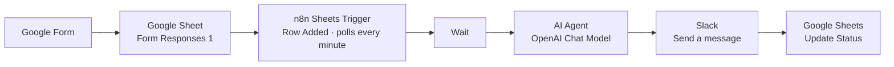

# Automating Lead Nurturing with No Code


An end-to-end, no-code lead pipeline. A new Google Form submission is saved to Google Sheets, qualified by an AI agent in n8n, and posted to Slack with a clear next step for the sales team.

---

## The Problem

Leads arrived through a form and sat in a spreadsheet until someone checked it. Follow-up was slow, inconsistent, and depended on a person reviewing every entry to decide which leads mattered most.

## The Solution

Every new submission triggers a workflow that:

1. Detects the new row in Google Sheets within one minute.
2. Uses an AI agent to classify the lead as **Hot**, **Warm**, or **Cold**, with a one-sentence rationale and a recommended next step.
3. Posts the lead's details and AI summary to a Slack channel.
4. Writes the lead's status back to the sheet.

Once published, the workflow runs on n8n's cloud, so it works without a computer staying on.

## Architecture



## Tech Stack

| Layer | Tool |
|---|---|
| Intake | Google Forms |
| Data store | Google Sheets |
| Orchestration | n8n Cloud |
| AI | OpenAI Chat Model (via n8n AI Agent) |
| Notifications | Slack |

## Workflow Steps

| # | Node | Purpose |
|---|---|---|
| 1 | Google Sheets Trigger | Fires on "Row Added" (polls every minute) |
| 2 | Wait | Brief buffer so the row is fully written |
| 3 | AI Agent | Returns Temperature, Summary, and Next step |
| 4 | Send a message (Slack) | Posts lead details plus AI summary |
| 5 | Update row in sheet | Writes Status back to the lead's row |

## Key Design Decision: Constraining the AI

The first version let the AI rewrite form answers. It changed "1 to 3 months" to "1–3 weeks" and altered an email address.

The fix:

- **Strict prompt rules.** The AI may only use approved status values and exact service and timeline labels, and it may not restate form data.
- **Separate data sources.** Slack pulls lead fields straight from the trigger. The AI only contributes its judgment, so lead facts never pass through the model.

**Takeaway:** Use deterministic data for facts and AI only for judgment.

## Results

- **Test leads processed:** 5
- **Form submission to Slack alert:** _[add measured time]_
- **Manual steps removed per lead:** _[add number]_
- **AI cost per lead:** under $0.001 with GPT-4o-mini

## Cost

- Slack, Google Sheets, and the Wait node use no AI tokens.
- Each lead uses about 400 to 600 AI tokens.
- Track actual usage on your OpenAI usage page.

## Repository Structure

```
.
├── README.md                    # Case study
├── workflow/                    # n8n workflow export (JSON)
├── prompts/ai-agent-prompt.txt  # Production AI prompt
├── slack/message-template.txt   # Slack message in Expression mode
├── test-data/test-leads.csv     # Five test leads
├── docs/
│   ├── setup-guide.md           # Step-by-step build guide
│   └── troubleshooting.md       # Common errors and fixes
└── screenshots/                 # Workflow and Slack screenshots
```

## Quick Start

1. Create the Google Form and link it to a Google Sheet.
2. Build the n8n workflow using the steps above.
3. Paste the prompt from `prompts/ai-agent-prompt.txt`.
4. Paste the Slack template from `slack/message-template.txt` in Expression mode.
5. Submit the leads in `test-data/test-leads.csv` one at a time.
6. Click **Publish**.

Full instructions are in [docs/setup-guide.md](docs/setup-guide.md).

## Lessons Learned

- **Publish is required.** Manual executions don't count as automatic runs.
- **Remove "Get row(s) in sheet" nodes.** Otherwise every new lead re-triggers the AI and Slack for all rows.
- **Bracket syntax for spaced field names:** `['Contact time']`.
- **Invite the Slack bot to the channel** before it can post.

## Future Improvements

- Route Hot leads to a dedicated channel or direct message the owner.
- Add a follow-up email for Cold leads.
- Log AI output to a review tab for quality checks.
- Send workflow errors to a monitoring channel.

## Author

**Ashif** · [GitHub](https://github.com/ashif204-dev) · Linkedin_[www.linkedin.com/in/ashif-hussain-532248314]_


